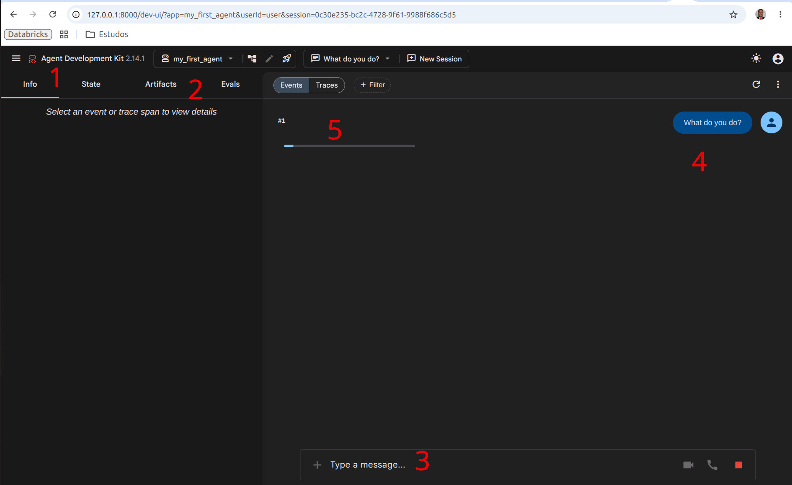
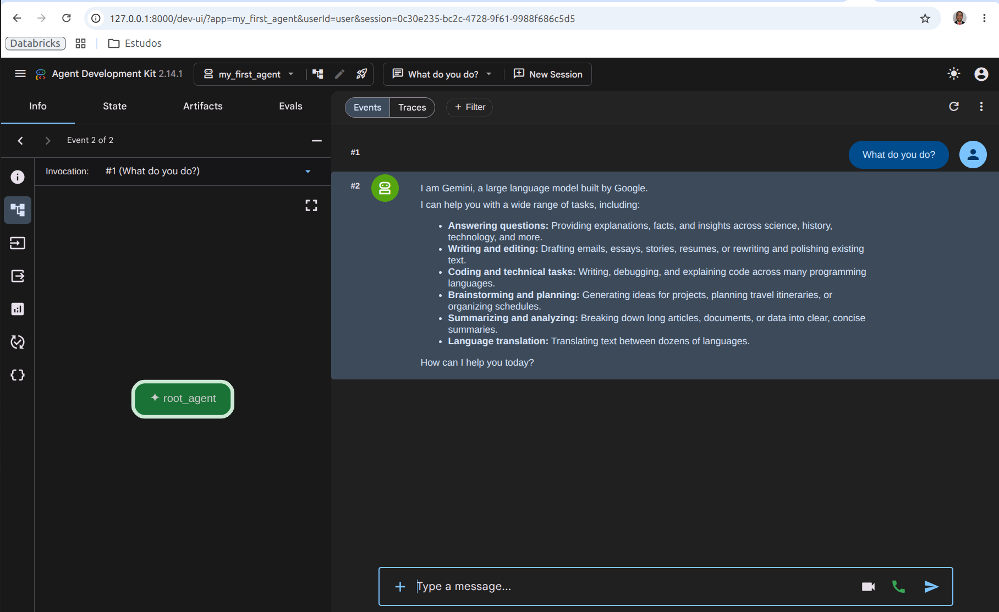

# Google - Agent Development Kit (ADK)

## Montagem do Ambiente
Estando na pasta "../Workspaces/"

### Cria uma pasta para os projetos do ADK
```sh
mkdir adk_workspace
cd adk_workspace
```

### Usar Python >= 3.11
```sh
pyenv local 3.12.3
```

### Cria o Ambiente Virtual
```sh
python -m venv .venv
```

### Ativa o Ambiente
```sh
python -m venv .venv
```

### Instala  ADK
```sh
pip install google-adk
```

### Verifica a versão
```sh
adk --version
```

### Crie e copie uma chave de API
Chave utilizada para acessar os modelos através da Gemini API. Deve ser criada em Google AI Studio com uma conta Google.
https://aistudio.google.com/apikey

### Autentica na GCP
```sh
gcloud auth application-default login
```

### Cria um Projeto
```sh
adk create my_first_agent
```

### Estrutura Criada
```
my_first_agent/
├── agent.py      # Main agent code (you’ll edit this)
├── __init__.py   # Python package initialization
└── .env          # Environment variables (you’ll edit this next)
```

### Código de agent.py
```python
from google.adk.agents import Agent

root_agent = Agent(
    model="gemini-flash-latest",
    name="root_agent",
    description="A helpful assistant agent.",
    instruction="You are a helpful assistant."
)
```

### Configure a Chave de API
Atualize a chave de API no arquivo .env com a chave criada no Google AI Studio
```.env
GOOGLE_API_KEY=your-actual-api-key-here
```

### Executar via ADK Web Console
```sh
adk web
```

Isso irá iniciar o servidor e a página do Console do ADK em: \
http://127.0.0.1:8000

Este console servirá de interface para iteragir com os agentes desenvolvidos.


## ADK Web Interface
### My First Agent
Requisição



- 1 = ADK version 2.14.1
- 2 = my_first_agent selecionado
- 3 = Caixa de Texto para chat com o agente
- 4 = Texto enviado ao agente
- 5 = Requisição sendo processada

---
\
Resposta




## Outras Maneiras de Execução
```sh
adk run: Interação via terminal

adk api_server: Deploy como um serviço API
```

## Re-execução
Estando na pasta "../Workspaces/adk_workspaces/"
```sh
source .venv/bin/activate
gcloud auth application-default login
adk web
```